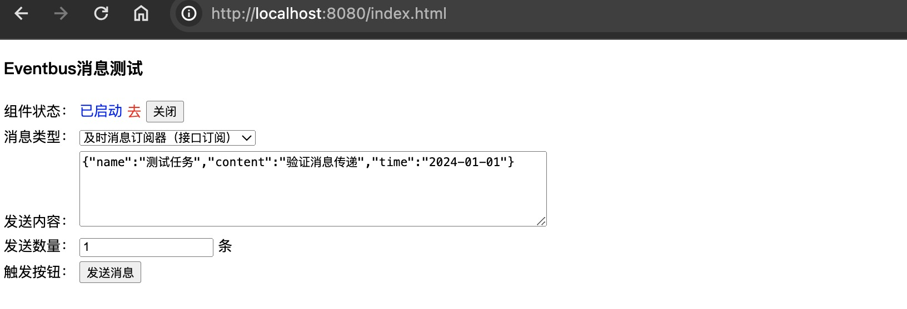

    

eventbus是基于Spring Boot Starter的分布式业务消息分发总线组件（发布/订阅模式），支持延时消息。可使用Redis、RabbitMQ、RocketMQ等任意一种做底层的消息引擎，🔝 🔝 🔝开源不易，点个Star关注更新吧。

Github项目地址：[https://github.com/likavn/eventbus](https://github.com/likavn/eventbus) <br/>
Gitee项目地址：[https://gitee.com/likavn/eventbus](https://gitee.com/likavn/eventbus)

## eventbus简介

eventbus是分布式业务消息分发总线组件，支持广播及时消息、延时消息等（即发布/订阅模式）。组件通过屏蔽底层不同种类的消息引擎，并提供统一的接口调用，可发送及时消息和延时消息，同时可订阅及时消息或延时消息等。当我们的应用引入eventbus组件时可降低系统耦合度。目前可选择基于Redis、RabbitMQ、RocketMQ等任意一种做底层的消息引擎，其他消息引擎中间件将被陆续支持。

注意：它不属于`消息中间件`，它是通过和消息中间件进行整合，来完成服务之间的消息通讯，类似于消息代理。

## 支持的消息中间件

- Redis
- RabbitMQ
- RocketMQ

## 有哪些特点

我们不是另外开发一个MQ，而是屏蔽底层不同种类的消息中间件，并提供统一的接口调用，旨在提供简单的事件处理编程模型，让基于事件的开发更灵活简单，结构清晰易于维护，扩展方便，集成使用更简单。

## 有哪些功能

- 消息：支持及时消息、延时消息的投递和接收，支持通过多种方式订阅消息，可通过统一的接口和注解方式去订阅接收消息；
- 失败重试：支持消息投递失败时投递重试，可自定义失败重试投递次数及下次投递时间；
- 拦截器：支持全局拦截器，可自主实现拦截逻辑，支持发送前拦截（`SendBeforeInterceptor `）、发送后拦截（`SendAfterInterceptor `
  ）、投递前拦截（`DeliverBeforeInterceptor`）、投递后拦截（`DeliverAfterInterceptor`）、最后一次投递仍然失败时拦截（
  `DeliverThrowableLastInterceptor`）；
- 消息轮询：通过注解[@Polling](./eventbus-annotation/src/main/java/com/github/likavn/eventbus/annotation/Polling.java)  自定义消息的轮询行为；
- 及时消息转换为延时消息：通过注解[@ToDelay](./eventbus-annotation/src/main/java/com/github/likavn/eventbus/annotation/ToDelay.java)定义消息类型转换，支持消息发送时，将消息转换为延时消息，延时消息支持延时投递，支持延时投递时间配置；
- 提供消息持久化示例，可参考[BsHelper](./eventbus-demo/springboot-demo/src/main/java/com/github/likavn/eventbus/demo/helper/BsHelper.java)，持久化消息投递状态，可便于后续处理；
- 可控的消息订阅监听器开关，如通过`Nacos`下线某个服务实例时需要同时关闭消息的监听；
- 支持无需修改代码，无缝切换消息中间件；
- 消息中间件网络断开重连机制，支持重连；

## 有哪些场景可以使用

- 单一业务分发消息进行异步处理时，比如业务完成推送业务数据给第三方；
- 支付时，后端服务需要定时轮询支付接口查询是否支付成功（可配置消息轮询）；
- 系统业务消息传播解耦，降低消息投递和接收的复杂度（消息可靠性传递）；
- 当我们需要切换消息中间件时，可以做到无缝切换，不需要修改业务代码；

## 版本要求

1. SpringBoot 2.3.0+
2. Redis 5.0+
3. RabbitMQ 3.8.0+
4. RocketMQ 4.0+

## 快速开始

### 引入依赖

项目中必须引入`eventbus-spring-boot-starter`组件依赖</br>
Spring Boot2

```xml
<!-- 必须引入 eventbus-spring-boot-starter组件-->
<dependency>
    <groupId>com.github.likavn</groupId>
  <artifactId>eventbus-spring-boot-starter</artifactId>
  <version>2.5.2</version>
</dependency>
```

Spring Boot3

```xml
<!-- 必须引入 eventbus-spring-boot-starter组件-->
<dependency>
    <groupId>com.github.likavn</groupId>
  <artifactId>eventbus-spring-boot3-starter</artifactId>
  <version>2.5.2</version>
</dependency>
```

`Json`序列化工具支持`Fast2json`、`Fastjson`、`Jackson`、`Gson`等任意一种。项目已引入`spring-boot-starter-web`时自带`Jackson`依赖，不需要单独引入其他`Json`工具依赖。如果项目中存在多个`Json`序列化工具依赖，序列化时的优先级如下:

```xml
<!-- 各JSON序列化工具 任选一个-->
<!-- fastjson2 -->
<dependency>
    <groupId>com.alibaba.fastjson2</groupId>
    <artifactId>fastjson2</artifactId>
    <version>${version}</version>
</dependency>
<!-- fastjson -->
<dependency>
     <groupId>com.alibaba</groupId>
     <artifactId>fastjson</artifactId>
     <version>${version}</version>
</dependency>
<!-- jackson 如果项目已引入spring-boot-starter-web，项目自带jackson依赖，不需要单独引入-->
<dependency>
     <groupId>com.fasterxml.jackson.core</groupId>
     <artifactId>jackson-databind</artifactId>
     <version>${version}</version>
</dependency>
<!-- gson -->
<dependency>
     <groupId>com.google.code.gson</groupId>
     <artifactId>gson</artifactId>
     <version>${version}</version>
</dependency>
```

### 设置消息中间件

在application.yml文件中配置消息引擎类型，如下：

```yaml
eventbus:
  type: redis  #redis或者rabbitmq、rocketmq
```

#### redis

使用Redis5.0 新功能Stream，Redis Stream 提供了消息的持久化和主备复制功能，可以让任何客户端访问任何时刻的数据，并且能记住每一个客户端的访问位置，还能保证消息不丢失。默认使用非阻塞轮询拉取Stream中的消息，可配置使用阻塞模式拉取消息。

注：redis 5.0~<6.2的版本删除过期消息是通过截取stream长度实现的，默认保留stream中的数据长度为10000条，>=6.2版本时可配置消息的超时时间，默认保留5天内的消息数据。延时消息接收并处理后，默认即刻删除stream中的消息。

需要在pom.xml单独引入，如下：

```xml
<dependency>
     <groupId>org.springframework.boot</groupId>
     <artifactId>spring-boot-starter-data-redis</artifactId>
</dependency>
<dependency>
     <groupId>org.apache.commons</groupId>
     <artifactId>commons-pool2</artifactId>
</dependency>
```

#### RabbitMQ

底层使用`RabbitMQ`发送延时消息时，需安装`RabbitMQ`的延时消息插件`rabbitmq_delayed_message_exchange`。

rabbitmq需要在pom.xml单独引入，如下：

```xml
<dependency>
    <groupId>org.springframework.boot</groupId>
    <artifactId>spring-boot-starter-amqp</artifactId>
</dependency>
```

#### RocketMQ

rocketmq需要在pom.xml单独引入（rocketMQ会引入fastjson），如下：

```xml
<dependency>
     <groupId>org.apache.rocketmq</groupId>
     <artifactId>rocketmq-spring-boot-starter</artifactId>
     <version>2.3.1</version>
</dependency>
```

### 发送与订阅及时消息

#### 显示编码

发送与订阅消息都显示的指定消息编码

发送消息

```java
@Resource
private MsgSender msgSender;

// 发送及时消息
// 第一个参数是业务消息code
// 第二个参数是业务消息Object实体对象数据
msgSender.send("testMsgSubscribe", "charging");
```

订阅消息

```java
/**
 * 订阅及时消息
 * 继承接口【MsgListener】并设置监听的消息实体对象
 */
@Component
@EventbusListener(codes = "testMsgSubscribe")
public class DemoMsgListener implements MsgListener<String> {
    // 接收业务消息体对象数据
    @Override
    public void onMessage(Message<String> message) {
        String body = message.getBody();
    }
}
```

#### 消息实体继承MsgBody接口

可让消息实体继承接口`MsgBody`，并可在实体中定义消息编码（可重写code方法，也可不重写，此时默认为继承`MsgBody`接口的bean实体类名称），使得同一消息编码的消息在定义监听器或发送消息时不需要单独设置消息编码。

定义消息实体

```java
@Data
public class TestBody implements MsgBody {
    private String content;

    // 可重写code方法，也可不重写，这里不重写时默认的消息编码code=TestBody （继承MsgBody接口类的名称）
    @Override
    public String code() {
        return MsgConstant.TEST_MSG_SUBSCRIBE_LISTENER;
    }
}
```

发送消息

```java
@Resource
private MsgSender msgSender;

// 发送消息
TestBody testBody = new TestBody();
testBody.setContent("这是一个测试消息！！！");
// 第一个参数是业务消息Object实体对象数据
msgSender.send(testBody);
```

订阅消息</br>
定义消息监听器（不需要指定消息编码），如下：

```java
@Slf4j
@Component
@EventbusListener
public class DemoMsgListener2 implements MsgListener<TestBody> {

    @Override
    public void onMessage(Message<TestBody> message) {
        TestBody body = message.getBody();
    }
}
```

#### 指定监听器实现类

发送消息

```java
// 发送消息
@Resource
private MsgSender msgSender;

// 发送消息
String testBody = "这是一个测试消息！！！";
// 第一个参数是及时消息监听器实现类
// 第二个参数是业务消息Object实体对象数据
msgSender.send(DemoMsgListener3.class, testBody);
```

订阅消息</br>
定义消息监听器（不需要指定消息编码，默认消息编码为监听器类名），如下：

```java
@Component
@EventbusListener
public class DemoMsgListener3 implements MsgListener<String> {
    @Override
    public void onMessage(Message<String> message) {
      String body = message.getBody();
    }
}
```

### 发送与订阅延时消息

注意：当消息引擎为rocketMq时，延时时间对应为rocketMq的18个延时级别。

#### 显示编码

发送与订阅消息都显示的指定消息编码

发送延时消息

```java
@Resource
private MsgSender msgSender;

// 发送延时消息
// 第一个参数是业务消息code
// 第二个参数是业务消息Object实体对象数据
// 第三个参数为延时时间，单位：秒，当消息引擎为rocketMq时，延时时间对应为rocketMq的18个延时级别。
msgSender.sendDelayMessage("testMsgSubscribe", "charging", 5);
```

订阅延时消息

```java
/**
 * 订阅延时消息
 * 继承接口【MsgDelayListener】并设置监听的消息实体对象
 */
@Component
@EventbusListener(codes = "testMsgSubscribe")
public class DemoDelayMsgListener implements MsgDelayListener<String> {
    // 接收业务消息体对象数据
    @Override
    public void onMessage(Message<String> message) {
        String body = message.getBody();
    }
}
```

#### 消息实体继承MsgBody接口

可让消息实体继承接口`MsgBody`，并可在实体中定义消息编码（可重写code方法，也可不重写，此时默认为继承`MsgBody`接口的bean实体类名称），使得同一消息编码的消息在定义监听器或发送消息时不需要单独设置消息编码。

定义延时消息消息实体

```java
@Data
public class TestBody implements MsgBody {
    private String content;

    // 可重写code方法，也可不重写，这里不重写时默认的消息编码code=TestBody （继承MsgBody接口类的名称）
    @Override
    public String code() {
        return "DelayCode";
    }
}
```

发送延时消息

```java
@Resource
private MsgSender msgSender;

// 消息实体
TestBody testBody = new TestBody();
testBody.setContent("这是一个测试消息！！！");

// 第一个参数是业务消息Object实体对象数据
// 第二个参数为延时时间，单位：秒，当消息引擎为rocketMq时，延时时间对应为rocketMq的18个延时级别。
msgSender.sendDelayMessage(testBody, 2);
```

订阅延时消息</br>
定义延时消息监听器（不需要指定消息编码），如下：

```java
@Slf4j
@Component
@EventbusListener
public class DemoDelayMsgListener2 implements MsgDelayListener<TestBody> {

    @Override
    public void onMessage(Message<TestBody> message) {
        TestBody body = message.getBody();
    }
}
```

#### 指定监听器实现类

发送延时消息

```java
@Resource
private MsgSender msgSender;

// 发送延时消息
String testBody = "这是一个测试消息！！！";
// 第一个参数是延时消息监听器实现类
// 第二个参数是业务消息Object实体对象数据
// 第三个参数为延时时间，单位：秒，当消息引擎为rocketMq时，延时时间对应为rocketMq的18个延时级别。
msgSender.sendDelayMessage(DemoDelayMsgListener3.class, testBody, 2);
```

订阅延时消息</br>
定义延时消息监听器（不需要指定消息编码，默认消息编码为监听器类名），如下：

```java
@Component
@EventbusListener
public class DemoDelayMsgListener3 implements MsgDelayListener<String> {
    @Override
    public void onMessage(Message<String> message) {
      String body = message.getBody();
    }
}
```

## 高级使用

### 定义监听器

使用`@EventbusListener`注解定义消息监听器，通常与`@Component`或`@Service`组合使用，提供4个参数进行配置：
1. `value` 消费者ID,默认为消费者类的全路径名称;
2. `serviceId` 消息所属来源服务ID或服务名。默认订阅本服务{@link BusConfig#getServiceId()}配置的ID，需要跨服务订阅消息时，可设置此值为对应的服务名；
3. `codes` 消息编码数组，可订阅多个不同的业务消息；
4. `concurrency` 消费者并发数量，及消费者数，默认：2；
5. `retryConcurrency`  重试消息的并发数量，默认：1。

如下：

```java
@Component
@EventbusListener(
    	serviceId = "EBServer",  // 监听消息所属服务ID 
        codes = "testStringListener", // 消息编码
        concurrency = 3,  // 消息接收并发数量
        retryConcurrency = 2 // 重试消息并发数量)
public class TestStringListener implements MsgListener<String> {

    @Override
    public void onMessage(Message<String> message) {
        System.out.println(message.getRequestId());
    }
}
```

### 异常捕获与重试

当消息投递失败时，可以自定义消息重复投递次数和下次消息投递时间间隔（系统默认重复投递3次，每次间隔10秒），即便这样，消息还是有可能会存在投递不成功的问题，可以使用注解`@FailRetry`标识在消息处理器的接收方法上。<br/>

提供三个参数进行配置：

1. `count` 消息投递失败时，一定时间内再次进行投递的次数，<code>count < 0</code> 时根据全局配置{@link BusConfig.Fail#getRetryCount()} 默认为3次；
2. `nextTime` 投递失败时，下次投递触发的间隔时间,单位：秒，用于固定间隔时间；
3. `interval` 定义了投递失败时，下次重试消息的时间间隔，可通过表达式（支持“+”、“-”、“*”、“/”等运算符）配置，表达式中可以使用三个变量：count（当前失败重试次数）、deliverCount（当前投递次数）和intervalTime（本次重试与上次投递的时间间隔，单位：秒）， 这使得可以灵活地根据重试次数和时间间隔来动态确定下一次重试的时间。

   引用变量时使用`$`+变量名，例如`$count`。 示例：

    - `interval=7`表示重试间隔为7秒;
    - `interval=$count*$intervalTime`表示重试间隔为当前重试次数与上次投递的时间间隔的乘积；
    - `interval=$deliverCount * 2`表示随着投递次数增加，下次重试时间也随着递增。

另外可通过编码`FailRetry.Keep.setNextTime()`方式动态设置下次重试时间，单位：秒。

几种获取有效的（间隔时间>0）下一次重试时间的方式，优先级从上至下：</br>
1.通过{@link FailRetry.Keep#setNextTime(long)}编码设置下次重试时间；</br>
2.通过{@link FailRetry#nextTime()}注解设置下次重试时间；</br>
3.通过{@link FailRetry#interval()}注解设置下次重试时间的表达式；</br>
4.根据全局配置{@link BusConfig.Fail#getNextTime()} 设置下次重试时间。</br>

如要捕获异常，需重写`failHandler`方法即可捕获投递错误异常及数据。如下：

```java
@Slf4j
@Component
@EventbusListener(codes = "testMsgSubscribe")
public class DemoMsgSubscribeListener implements MsgListener<String> {
    // 接收业务消息体对象数据
    // @FailRetry消息投递失败时重试，这里设置重试2次，下次重试间隔5秒（引擎为rocketMq时，此处延时时间对应为rocketMq的18个延时级别）后触发
    @Override
    @FailRetry(retry = 2, nextTime = 5)
    public void onMessage(Message<String> message) {
        String body = message.getBody();
        log.info("接收数据: {}", message.getRequestId());
        // throw new RuntimeException("DemoMsgSubscribeListener test");
    }

    /**
     * 消息投递异常捕获
     */
    @Override
    public void failHandler(Message<String> message, Throwable throwable) {
        log.error("消息投递失败！: {}，{}", message.getRequestId(), throwable.getMessage());
    }
}
```

### 消息轮询

在消息监听器的方法上配置注解[@Polling](./eventbus-annotation/src/main/java/com/github/likavn/eventbus/annotation/Polling.java)
即可让同一消息重复轮询接收，可配置count（最大轮询次数，可通过编码方式`Polling.Keep.over()`
提前终止轮询）、nextTime（下一次轮询触发的时间间隔，单位：秒，用于固定间隔时间）、interval（轮询间隔时间，单位：秒），值可以为数字也可为计算间隔时间的表达式（引用变量时使用`$`+变量名，例如`$count`）。

注：`interval`表达式中可以使用以下三个变量，count（当前轮询次数）、deliverCount（当前投递次数）和intervalTime（本次轮询与上次轮询的时间间隔，单位为秒，非延时消息初始时为:1）

示例：

1. `interval=7`，表示轮询间隔为7秒。
2. `interval=$count*$intervalTime`，表示轮询间隔为当前轮询次数与上次轮询的时间间隔的乘积。
3. `interval=$deliverCount * 3`表示随着投递次数增加，下次重试时间也随着递增。

另外可通过编码`Polling.Keep.setNextTime()`方式动态设置下次轮巡时间间隔，单位：秒。

几种计算下一次轮巡时间的方式，优先级从上至下：</br>
1.通过{@link Polling.Keep#over()}或{@link Keep#setNextTime(long)}设置；</br>
2.通过{@link Polling#nextTime()}设置；</br>
3.通过{@link Polling#interval()}设置；</br>

如下：

```java
@Component
@EventbusListener(codes = "testMsgPolling")
public class DemoMsgListener implements MsgListener<TestBody> {
    @Override
    @Polling(count = 2, interval = "$count * $intervalTime + 5")
    public void onMessage(Message<TestBody> message) {
        TestBody body = message.getBody();
        log.info("接收数据: {}", message.getRequestId());
        //   throw new RuntimeException("DemoMsgListener test");

        if (message.getDeliverCount() > 1) {
            // 终止轮询
            Polling.Keep.over();
        }
    }
}
```

### 及时转成延时消息

在及时消息监听器的方法上配置注解[@ToDelay](./eventbus-annotation/src/main/java/com/github/likavn/eventbus/annotation/ToDelay.java)  即可让及时消息转成延时消息并接收处理。示例：[DemoMsgListener](./eventbus-demo/springboot-demo/src/main/java/com/github/likavn/eventbus/demo/listener/DemoMsgListener.java) </br>

参数配置：</br>
delayTime ：延迟时间，单位：秒。</br>
firstDeliver ：是否需要及时消息进行首次投递，默认：false (第一次接收到及时消息时不投递，只投递延时消息）。</br>

```java
/**
 * codes : 消息code
 * concurrency : 并发数
 */
@Component
@EventbusListener(codes = "testMsgToDelay")
public class DemoMsgListener implements MsgListener<TestBody> {

    @Override
    @ToDelay(delayTime = 3)
    public void onMessage(Message<TestBody> msg) {
        TestBody body = msg.getBody();
    }
}
```

### 自定义消息ID

RequestId（消息ID）默认使用UUID，若需修改为其他类型的ID，可实现接口[RequestIdGenerator](./eventbus-core/src/main/java/com/github/likavn/eventbus/core/api/RequestIdGenerator.java) 时重写`nextId()`方法并配置即可。

接口：

```java
public interface RequestIdGenerator {
    /**
     * 获取请求ID
     *
     * @return 请求ID
     */
    String nextId();
}
```

实现并配置：

```java
@Configuration
public class EventbusConfiguration {

    @Bean
    public RequestIdGenerator requestIdGenerator() throws UnknownHostException {
        Sequence sequence = new Sequence(InetAddress.getLocalHost());
        // RequestIdGenerator接口实现
        return () -> String.valueOf(sequence.nextId());
    }
}
```

### 自定义JSON序列化工具

当前`Json`序列化支持`Fast2json`、`Fastjson`、`Jackson`、`Gson`等任意一种，如果当前项目同时存在相关依赖时，序列化使用的`Json`工具优先级也同上顺序。若需调整顺序或使用其他`Json`序列化工具时，可以自定义`Json`实现，需实现接口[IJson](./eventbus-core/src/main/java/com/github/likavn/eventbus/core/support/spi/IJson.java)。

接口：

```java
public interface IJson {
    /**
     * json工具类名称,如："com.alibaba.fastjson2.JSON"
     *
     * @return name
     */
    String className();

    /**
     * to json string
     *
     * @param value v
     * @return json str
     */
    String toJsonString(Object value);

    /**
     * json 转对象
     *
     * @param text text
     * @param type to bean class
     * @return bean
     */
    <T> T parseObject(String text, Type type);

    /**
     * 当存在多个可用的json工具时，优先使用order最小的
     *
     * @return order 顺序
     */
    int getOrder();
}
```

创建JsonProvider并实现接口IJson，需重写className、toJsonString、parseObject、getOrder等方法即可，可参考[Fast2jsonProvider](./eventbus-core/src/main/java/com/github/likavn/eventbus/core/support/Fast2jsonProvider.java)的实现，实现代码如下：

```java
public class Fast2jsonProvider implements IJson {  
    @Override
    public String className() {
        return "com.alibaba.fastjson2.JSON";
    }

    @Override
    public String toJsonString(Object value) {
        return JSON.toJSONString(value);
    }

    @Override
    public <T> T parseObject(String text, Type type) {
        return JSON.parseObject(text, type);
    }

    @Override
    public int getOrder() {
        return 1;
    }
}
```

这里使用的是Java的`SPI`机制，故需在项目的`META-INF/services`目录下添加`com.github.likavn.eventbus.core.support.spi.IJson`文件，文件内容如下：

```java
com.github.likavn.eventbus.core.support.Fast2jsonProvider
```

### 消息监听器开关

可控的消息监听器开关，如通过`Nacos`下线某个服务实例时需要同时关闭消息的监听。

```java
@Resource 
MsgListenerContainer msgListenerContainer;

// 打开消息监听
msgListenerContainer.startup();

// 关闭消息监听
msgListenerContainer.shutdown();
```

### 切换消息中间件

eventbus支持多种消息引擎，如：redis、rabbitmq、rocketmq，如果项目前期使用redis，后续需要切换到rabbitmq，可不在修改代码的同时使得当前服务可以监听原有redis中的消息，配置如下：

```yaml
eventbus:
  oldType: redis # 原消息引擎类别，消息引擎没做迁移时可不做配置
  type: rabbitmq # 切换后的消息引擎类别
```

### 全局消息拦截器

`eventbus`提供全局的消息拦截器，包含消息发送前拦截器、消息发送后拦截器、消息投递前拦截器、消息投递后拦截器、异常重试最后一次投递仍然失败拦截器。可根据消息的重要性需求实现对应的拦截器接口，如对消息及消息的投递消费者状态进行数据库持久化操作，参考：[BsHelper](eventbus-demo/springboot-demo/src/main/java/com/github/likavn/eventbus/demo/helper/BsHelper.java)。
如果存在多个同类型拦截器实例可使用[@Order](eventbus-annotation/src/main/java/com/github/likavn/eventbus/annotation/Order.java)注解标识优先级。

#### 发送前拦截器

消息发送前拦截器：[SendBeforeInterceptor](./eventbus-core/src/main/java/com/github/likavn/eventbus/core/api/interceptor/SendBeforeInterceptor.java)实现接口方法`execute`即可，如下示例是消息发送前持久化消息的实例代码，参考：[DemoSendBeforeInterceptor](eventbus-demo/springboot-demo/src/main/java/com/github/likavn/eventbus/demo/interceptor/DemoSendBeforeInterceptor.java)

```java
@Slf4j
@Component
public class DemoSendBeforeInterceptor implements SendBeforeInterceptor {
  @Lazy
  @Resource
  private BsHelper bsHelper;

  @Override
  public void execute(Request<String> request) {
    // 重试时，不记录消息
    if (request.isRetry()) {
      return;
    }
    bsHelper.saveMessage(request);
  }
}
```

#### 发送后拦截器

消息发送后拦截器：[SendAfterInterceptor](./eventbus-core/src/main/java/com/github/likavn/eventbus/core/api/interceptor/SendAfterInterceptor.java)实现接口方法`execute`即可。

#### 消费前拦截器

消息投递消费者前拦截器：[DeliverBeforeInterceptor](./eventbus-core/src/main/java/com/github/likavn/eventbus/core/api/interceptor/DeliverBeforeInterceptor.java)
实现接口方法`execute`即可，如下示例是消息消费成功后更新消息的投递状态示例代码，

```java
@Component
public class DemoDeliverBeforeInterceptor implements DeliverBeforeInterceptor {
    @Resource
    private BsHelper bsHelper;

    @Override
    public void execute(Request<String> request) {
        bsHelper.deliverSuccess(request);
    }
}
```

#### 消费后拦截器

消息投递消费者后拦截器：[DeliverAfterInterceptor](./eventbus-core/src/main/java/com/github/likavn/eventbus/core/api/interceptor/DeliverAfterInterceptor.java)
实现接口方法`execute`
即可，如下示例是消息消费后更新消息的投递状态示例代码，参考：[DemoDeliverAfterInterceptor](eventbus-demo/springboot-demo/src/main/java/com/github/likavn/eventbus/demo/interceptor/DemoDeliverAfterInterceptor.java)

```java
public class DemoDeliverAfterInterceptor implements DeliverAfterInterceptor {
  @Lazy
  @Resource
  private BsHelper bsHelper;

  @Override
  public void execute(Request<String> request, Throwable throwable) {
    // 无异常信息标识当前消息成功投递
    if (null == throwable) {
      bsHelper.deliverSuccess(request);
      return;
    }
    log.info("消息投递异常 execute->{}", throwable.getMessage());
    bsHelper.deliverException(request, throwable);
  }
}
```

#### 消费异常最后一次重试拦截器

消息投递消费者失败拦截器（消息重试投递都失败时，最后一次消息投递仍然失败时会调用该拦截器）：[DeliverThrowableLastInterceptor](./eventbus-core/src/main/java/com/github/likavn/eventbus/core/api/interceptor/DeliverThrowableLastInterceptor.java)
实现接口方法`execute`即可，
如下示例是消息消费失败后更新消息的投递状态示例代码，参考：[DemoDeliverThrowableLastInterceptor](eventbus-demo/springboot-demo/src/main/java/com/github/likavn/eventbus/demo/interceptor/DemoDeliverThrowableLastInterceptor.java)

```java
@Component
public class DemoDeliverThrowableLastInterceptor implements DeliverThrowableLastInterceptor {
    @Resource
    private BsHelper bsHelper;

    @Override
    public void execute(Request<String> request, Throwable throwable) {
        bsHelper.deliverException(request, throwable);
    }
}
```

## 配置

`BusProperties`，在application.yaml中eventbus配置以 `eventbus` 开头，所有配置如下：


| 节点        | key                             | 数据类型 | 备注                                                                                                      |
| ----------- | ------------------------------- | -------- | --------------------------------------------------------------------------------------------------------- |
| eventbus    |                                 |          | eventbus配置                                                                                              |
| eventbus    | serviceId                       | string   | 服务ID/消息来源ID，可以不用配置，默认等于${spring.application.name}的值。                                 |
| eventbus    | type                            | string   | 消息引擎类别（redis、rabbitmq、rocketmq）                                                                 |
| eventbus    | oldType                         | string   | 原消息引擎类别（redis、rabbitmq、rocketmq），用于消息引擎切换时兼容原始消息，消息引擎没做迁移时可不做配置 |
| eventbus    | concurrency                     | int      | 消息接收并发数，默认为：2                                                                                 |
| eventbus    | retryConcurrency                | int      | 重发/重试消息接收并发数，默认为：1                                                                        |
| eventbus    | msgBatchSize                    | int      | 单次获取消息数量，默认：16条                                                                              |
| eventbus    | testConnect                     |          | 消息引擎服务节点联通性配置                                                                                |
| testConnect | pollSecond                      | int      | 轮询检测时间间隔，单位：秒，默认：35秒进行检测一次                                                        |
| testConnect | loseConnectMaxMilliSecond       | int      | 丢失连接最长时间大于等于次值设置监听容器为连接断开，单位：秒，默认：120秒                                 |
| eventbus    | fail                            |          | 消息投递失败时配置                                                                                        |
| fail        | retryCount                      | int      | 消息投递失败时，一定时间内再次进行投递的次数，默认：3次                                                   |
| fail        | nextTime                        | int      | 失败重试下次触发时间，单位：秒，默认10秒 。（rocketMq请修改为对应为18个延时消息级别）                     |
| eventbus    | redis                           |          | redis配置                                                                                                 |
| redis       | pollThreadPoolSize              | int      | 轮询时拉取Redis Stream中消息的线程池大小，默认为：2                                                       |
| redis       | pollBlockMillis                 | long     | 轮询时拉取Redis Stream中消息的阻塞时间，单位：毫秒，默认为：5ms                                           |
| redis       | deliverGroupThreadPoolSize      | int      | 投递消息的初始化线程池大小，默认为：5                                                                     |
| redis       | deliverGroupThreadKeepAliveTime | long     | 投递消息线程池中空闲线程存活时长，单位：毫秒，默认为：60s                                                 |
| redis       | deliverTimeout                  | int      | 消息超时时间，超时消息未被确认，才会被重新投递，单位：秒，默认：5分钟                                     |
| redis       | pendingMessagesBatchSize        | int      | 未确认消息，重新投递时每次最多拉取多少条待确认消息数据，默认：100条                                       |
| redis       | streamExpiredHours              | int      | stream 过期时间，6.2及以上版本支持，单位：小时，默认：3 天                                                |
| redis       | streamExpiredLength             | int      | stream 过期数据截取，值为当前保留的消息数，5.0~<6.2版本支持，单位：条，默认：10000条                      |

## 接口信息


| 接口                                                                                                                                                  | 说明                                                                                             | 示例                                                                                                                                                                                                                                                          |
| ----------------------------------------------------------------------------------------------------------------------------------------------------- | :----------------------------------------------------------------------------------------------- | ------------------------------------------------------------------------------------------------------------------------------------------------------------------------------------------------------------------------------------------------------------- |
| [MsgSender](./eventbus-core/src/main/java/com/github/likavn/eventbus/core/api/MsgSender.java)                                                         | 消息的生产者sender,用于消息的发送                                                                | [TriggerController](./eventbus-demo/springboot-demo/src/main/java/com/github/likavn/eventbus/demo/controller/TriggerController.java)                                                                                                                          |
| [MsgListener](./eventbus-core/src/main/java/com/github/likavn/eventbus/core/api/MsgListener.java)                                                     | 接收及时消息的处理器接口类                                                                       | [MsgListener ](./eventbus-demo/springboot-demo/src/main/java/com/github/likavn/eventbus/demo/listener/MsgListener.java)<br/>[MsgListener2](./eventbus-demo/springboot-demo/src/main/java/com/github/likavn/eventbus/demo/listener/MsgListener2.java)          |
| [MsgDelayListener](./eventbus-core/src/main/java/com/github/likavn/eventbus/core/api/MsgDelayListener.java)                                           | 接收延时消息的处理器接口类                                                                       | [MsgDelayListener ](./eventbus-demo/springboot-demo/src/main/java/com/github/likavn/eventbus/demo/listener/MsgDelayListener.java)                                                                                                                             |
| [@EventbusListener](./eventbus-annotation/src/main/java/com/github/likavn/eventbus/annotation/EventbusListener.java)                                   | @EventbusListener 注解，用于标识是Eventbus消息监听器的注解                                       | [MsgListener ](./eventbus-demo/springboot-demo/src/main/java/com/github/likavn/eventbus/demo/listener/MsgListener.java)<br/>[MsgDelayListener ](./eventbus-demo/springboot-demo/src/main/java/com/github/likavn/eventbus/demo/listener/MsgDelayListener.java) |
| [@FailRetry](./eventbus-annotation/src/main/java/com/github/likavn/eventbus/annotation/FailRetry.java)                                                 | @FailRetry 注解，用于在接收消息投递异常时定义重试次数和下次触发时间                              | [MsgListener](./eventbus-demo/springboot-demo/src/main/java/com/github/likavn/eventbus/demo/listener/MsgListener.java)                                                                                                                                        |
| [SendBeforeInterceptor](./eventbus-core/src/main/java/com/github/likavn/eventbus/core/api/interceptor/SendBeforeInterceptor.java)                     | 发送前全局拦截器                                                                                 | [DemoSendBeforeInterceptor](./eventbus-demo/springboot-demo/src/main/java/com/github/likavn/eventbus/demo/interceptor/DemoSendBeforeInterceptor.java)                                                                                                         |
| [SendAfterInterceptor](./eventbus-core/src/main/java/com/github/likavn/eventbus/core/api/interceptor/SendAfterInterceptor.java)                       | 发送后全局拦截器                                                                                 | [DemoSendAfterInterceptor](./eventbus-demo/springboot-demo/src/main/java/com/github/likavn/eventbus/demo/interceptor/DemoSendAfterInterceptor.java)                                                                                                           |
| [DeliverBeforeInterceptor](./eventbus-core/src/main/java/com/github/likavn/eventbus/core/api/interceptor/DeliverBeforeInterceptor.java)               | 投递消费者前全局拦截器                                                                           |                                                                                                                                                                                                                                                               |
| [DeliverAfterInterceptor](./eventbus-core/src/main/java/com/github/likavn/eventbus/core/api/interceptor/DeliverAfterInterceptor.java)                 | 投递消费者后全局拦截器                                                                           | [DemoDeliverAfterInterceptor](./eventbus-demo/springboot-demo/src/main/java/com/github/likavn/eventbus/demo/interceptor/DemoDeliverAfterInterceptor.java)                                                                                                     |
| [DeliverThrowableLastInterceptor](./eventbus-core/src/main/java/com/github/likavn/eventbus/core/api/interceptor/DeliverThrowableLastInterceptor.java) | 投递消费者异常全局拦截器<br/> * 注：消息重复投递都失败时，最后一次消息投递失败时才会调用该拦截器 | [DemoDeliverThrowableLastInterceptor](./eventbus-demo/springboot-demo/src/main/java/com/github/likavn/eventbus/demo/interceptor/DemoDeliverThrowableLastInterceptor.java)                                                                                             |
| [@ToDelay](./eventbus-annotation/src/main/java/com/github/likavn/eventbus/annotation/ToDelay.java)                                                     | @ToDelay 注解用于接收及时消息的方法上，使得当前消息转成延时消息。                                | [MsgListenerClassName](./eventbus-demo/springboot-demo/src/main/java/com/github/likavn/eventbus/demo/listener/MsgListenerClassName.java)                                                                                                                                |
| [@Polling](./eventbus-annotation/src/main/java/com/github/likavn/eventbus/annotation/Polling.java)                                                     | @Polling 注解用在接收消息的方法上，以控制消息订阅的轮询行为。                                    | [MsgListener](./eventbus-demo/springboot-demo/src/main/java/com/github/likavn/eventbus/demo/listener/MsgListener.java)                                                                                                                                |

更多信息请查阅相关接口类...

## 架构

详情见[架构知之](./doc/架构知之.md)

## 示例

示例项目需配置数据库，初始化数据库sql：[demo-init.sql](./doc/sql/demo-init.sql)

启动springboot-demo访问http://localhost:8080/index.html <br/>


## 注意事项

**订阅、广播消息在消息引擎中是以监听器实现类全类名实现，请谨慎重新命名监听器，当我们不在需要某个监听器请及时在消息引擎中删除此分组或队列，避免不必要的存储空间浪费。消息监听器只能是及时/延时其中的一种类型，同一个消息监听器不可能同时监听及时和延时消息**

## 联系我

本项目会持续更新和维护，喜欢别忘了Star，有问题可通过微信、QQ及时与我联系(请备注来源平台及来意)，谢谢您的关注。

微信：likavn

QQ：1085257460
